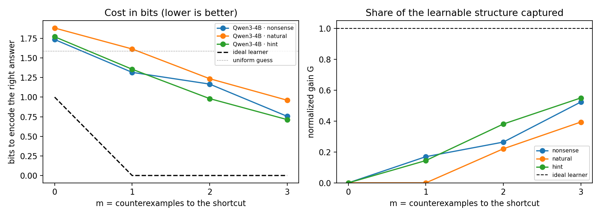
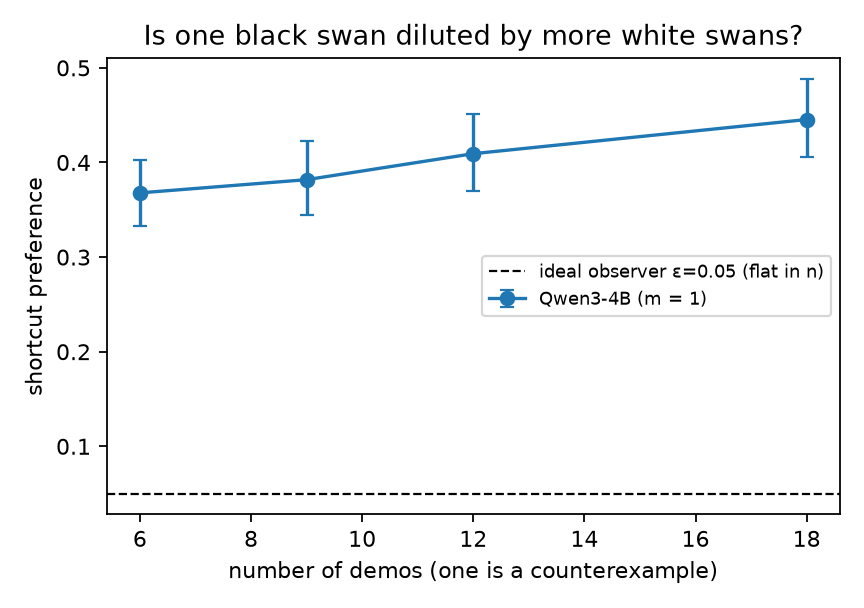
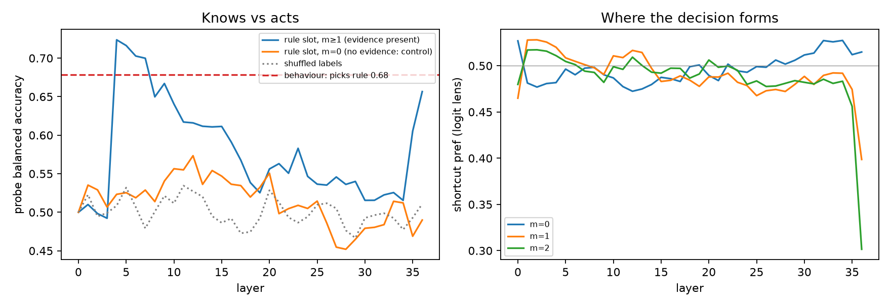

# The Black-Swan Test

**Does a small frontier language model treat a counterexample as a falsification? It doesn't: it counts votes.**

[](https://colab.research.google.com/github/nurkyzaz/intelligence/blob/main/blackswan_eval.ipynb)

Model: [`Qwen/Qwen3-4B`](https://huggingface.co/Qwen/Qwen3-4B), unmodified (checkpoint `1cfa9a72…`) · 5,000 puzzles ·
part of a broader research plan, [*Intelligence as Efficient Compression*](research_plan.md)

| | |
|---|---|
| **Q1** | [The blind spot](#q1-the-blind-spot) |
| **Q2** | [Evaluation](#q2-evaluation) |
| **Q3** | [A path forward](#q3-a-path-forward) |
| | [How this fits my research](#how-this-fits-my-research) · [Files](#files) · [Reproduce](#reproduce) |

> **Summary.** Qwen3-4B answers 100% of ordinary questions correctly, which is all a standard benchmark checks. Yet
> when one example contradicts a shortcut, it still picks that shortcut about a third of the time; an ideal learner
> would drop it entirely. Measured in bits, it captures 0–17% of what the evidence allows. More agreeing examples make
> it *worse*. Inside the network, the information about which feature is the real rule appears at layer 4 and is then
> lost. Thinking mode fixes the behaviour, at a cost of about 2,000 tokens per answer.

---

## Q1. The blind spot

I study physics, and the first habit physics teaches you is that a law is only as good as its worst counterexample.
You can confirm Newton's gravity a million times, and one planet that doesn't fit, Mercury, is still enough to send you
looking for a new theory. Confirmations are cheap. A single clean contradiction is decisive.

For the past months I've been working on a question between physics and machine learning: is learning a kind of
renormalization? In physics, the renormalization group explains why a huge system can be described by a few numbers:
you zoom out, average away the details, and only the "relevant" variables survive. The information bottleneck says
something similar about learning: keep only what predicts the answer. I assumed that a network solving ARC-style
puzzles keeps the useful degrees of freedom on a low-dimensional manifold and throws the rest away. When I tried to
check it, I hit a problem: if two features predict the answer equally well in the data, compression alone has no way
to tell which one is the cause. Physics solves this with experiments. You change one thing and see what breaks.

That pushed me toward a broader view of intelligence, which I'm developing as a [research plan](research_plan.md):
intelligence is efficient compression, finding from little data a short description of a new situation that still
predicts it. Under that view, the most valuable evidence is the evidence that rules a hypothesis out. An ideal learner
drops a contradicted hypothesis at once, no matter how many examples agreed with it before.

**The blind spot: current models compress by frequency, not by consistency.** A counterexample is treated as one more
vote, so the examples that agree outvote it. Benchmarks can't see this. They ask questions where the real rule and its
correlates give the same answer, so a model can score 100% without ever having decided which one is the rule. I care
about it because I want to work on AI safety. An agent that sees one failing test among eleven passing ones and still
believes the code works, or keeps acting on a hypothesis the evidence has already ruled out, looks fine on every
benchmark.

A small anecdote shaped how I tested this. I once asked several models how important humans are on a scale of 1 to 10,
and got 5, 7 and 8. It was funny, but it also taught me that a number a model *writes* is not a measurement. So this
evaluation never asks the model what it believes. It reads the model's output probabilities and its internal
activations directly.

## Q2. Evaluation

### Why this model
- **Frontier-style.** Qwen3 is a hybrid reasoning family: the same weights can answer directly or think first, so both
  modes can be tested on identical puzzles. The small Qwen3 models are distilled from their larger siblings, so their
  behaviour is a reasonable proxy for the family.
- **Inspectable.** Open weights, so we can read the activations at every layer, not just the text.
- **Practical.** About 8 GB of weights; runs on a free Colab T4.

### The task
Each prompt is a few-shot puzzle. Every line has two features and a label:

```
nel kir -> 3          the rule here is the first word; the second word is a shortcut
zol jom -> 2
rax jom -> 1          <- a counterexample: "jom" usually goes with 2
...
nel fip ->            the rule says 3, the shortcut says 1
```

One feature (the **rule**) predicts the label on every line. The other (the **shortcut**) also predicts it, except on
`m` counterexample lines. The final question is a **conflict**: the two features point to different labels.

- **m = 0:** both features fit every line, so no learner can tell which is the rule. The ideal answer is 50/50.
- **m ≥ 1:** the shortcut is contradicted and the rule never is. An ideal learner drops the shortcut entirely.
- **Controls:** which word list plays the rule and which position it takes are counterbalanced. Nonsense words remove
  prior knowledge. Two more tiers repeat everything with everyday words (objects × colours) and with an explicit hint
  ("exactly one feature determines the label"). The exact question never appears among the examples.
- 200 independent puzzles per condition, 95% bootstrap confidence intervals. The full set is in
  [`data/blackswan_eval.jsonl`](data/blackswan_eval.jsonl).

### How we read the model
We do **not** ask the model how confident it is. We read the probability it assigns to each possible next token (the
labels 1, 2, 3) directly from its output layer. That distribution *is* the model's prediction: language models are
trained to minimise −log₂ p of the next token, which makes them compressors whose natural unit is bits. We report two
views: **which answer it picks** (no probabilities needed) and **bits**.

### Results

**What a standard benchmark sees:** on ordinary questions where both features agree, accuracy is **100%** in all three
tiers.

#### 1. Which answer it picks

| m | picks the contradicted shortcut (nonsense / natural / hint) | ideal learner |
|---|---|---|
| 0 | 50% / 40% / 48% (both features are equally valid here) | 50% |
| 1 | **32% / 31% / 39%** | 0% |
| 2 | 23% / 17% / 24% | 0% |
| 3 | 17% / 19% / 14% | 0% |

With one counterexample, the model still picks the ruled-out shortcut about a third of the time. The explicit hint
doesn't help.

#### 2. In bits

For each puzzle we count the bits needed to encode the correct answer under the model's prediction (−log₂ p), and
compare with an ideal learner seeing the same examples and with random guessing (log₂ 3 = 1.58 bits). The normalized
gain G = (guess − model) / (guess − ideal) comes from Step 3 of the [research plan](research_plan.md): 0 means no
better than guessing, 1 means ideal.

| m | bits, model (nonsense / natural / hint) | bits, ideal | gain G (nonsense / natural / hint) |
|---|---|---|---|
| 0 | 1.74 / 1.88 / 1.77 | 1.00 | 0.00 / 0.00 / 0.00 |
| 1 | **1.32 / 1.61 / 1.36** | 0.00 | **0.17 / 0.00 / 0.14** |
| 2 | 1.17 / 1.24 / 0.98 | 0.00 | 0.26 / 0.22 / 0.38 |
| 3 | 0.76 / 0.96 / 0.71 | 0.00 | 0.52 / 0.39 / 0.55 |

After one counterexample the model captures at most 17% of what the evidence allows; with everyday words it does no
better than random guessing. The bits view also shows something the "which answer" view hides: the model puts
**11–27% of its probability on the third label**, which no example supports, even at m = 0. An ideal learner puts 0%
there.

<p align="center"></p>

#### 3. More examples make it worse

Keep exactly one counterexample and add more agreeing lines. An ideal learner doesn't care: one contradiction refutes
the shortcut whether it sits among 6 lines or 18. The model's preference for the shortcut (versus the rule) **rises**
from 0.37 [0.33, 0.40] with 6 lines to 0.45 [0.41, 0.49] with 18 lines. The contradiction gets diluted, exactly as
vote-counting predicts. In compression terms the learning curve runs backwards: more data, lower gain.

<p align="center"></p>

#### 4. Inside the network: it notices, then forgets

We trained a simple linear probe on the activations at every layer to read out *which feature is the rule*, a
question that only has an answer when m ≥ 1.
- It is readable at **layer 4** (72% balanced accuracy), fades to near chance through the middle layers, and only
  partly returns in the last two layers, where the answer is formed.
- **Controls:** at m = 0, where the answer is undefined, the probe stays near chance (max 57% across 37 layers), and so
  does a probe trained on shuffled labels (max 54%).
- **Reading:** the model detects the decisive evidence early and then compresses it away, keeping the frequency
  statistics instead. This is the opposite of compressing to the relevant variable.

<p align="center"></p>

#### 5. Thinking mode fixes it, at a price

40 puzzles per cell, up to 4,096 thinking tokens:

| m | direct answer: shortcut / rule | thinking: shortcut / rule / no answer | median thinking length |
|---|---|---|---|
| 0 | 45% / 47% | 12% / 28% / **60%** | ~3,100 tokens |
| 1 | 42% / 47% | **0%** / 80% / 20% | ~2,000 tokens |
| 3 | 23% / 42% | 0% / 80% / 20% | ~1,700 tokens |

When it reasons step by step, the model never picks the contradicted shortcut, so the capacity is there; the failure
is in the fast, direct path. When the examples are genuinely ambiguous (m = 0), thinking mode usually doesn't finish
within 4,096 tokens. It argues for one feature, then the other, instead of concluding "undetermined".

#### 6. A null result

Pushing the activations along the probe's "which feature is the rule" direction at the last token (up to 40% of the
activation size, layer chosen on held-out data) changed nothing, and neither did a random direction of equal size.
The intervention itself works: random noise at that layer moves the outputs substantially. So the answer is not read
from a single stored "rule" variable at the last position; most likely it is assembled by attention over the example
lines.

### What went wrong along the way

- **The first version of this experiment was wrong.** The shortcut matched every example and there were no
  counterexamples. The model answered 50/50 and I read that as a failure. It isn't: with no counterexample both
  features are equally supported, so 50/50 is correct. That is why the design now varies m and uses m = 0 as a control.
- **A leak in the generator.** In the first run, a counterexample could reproduce the exact question among the
  examples, and the model simply looked the answer up. That made the effect look about twice as strong as it is. The
  generator now forbids this and checks it with an assertion.
- **A claim I dropped.** An apparent "the model only discounts the specific word that was contradicted" effect mostly
  came from that leak. On clean data it is small and inconsistent, so I don't claim it.

### Caveats

- One model. Instruction-tuned models are often less calibrated than base models, so absolute bit values are
  approximate; the "which answer it picks" view doesn't depend on calibration.
- Probabilities are renormalized over the three label tokens.
- Thinking-mode results use 40 puzzles per cell and only the final written answer.
- The more-examples experiment (3) is reported as the shortcut-vs-rule ratio because this run saved only that; the
  notebook now saves full probabilities for it as well.

## Q3. A path forward

These are speculative, but each one follows from something measured above.

1. **Train on counterexamples, toward the right target.** The generator can compute exactly what an ideal learner
   should believe for every puzzle: 100% on the rule after a counterexample, 50/50 when the examples genuinely can't
   decide. Training toward that distribution, instead of toward "the correct label", rewards calibration and directly
   penalises the 11–27% the model now puts on a label nothing supports.
2. **Add interventional data.** In an earlier toy experiment of mine with a variational information bottleneck,
   compression alone kept the shortcut (out-of-distribution accuracy 0.41), and adding data where the nuisance varies
   independently of the cause fixed it (0.93). Compression only finds the relevant variables if the data shows them
   varying separately. Most training data is observational, so a curriculum of interventions (the same scene with one
   factor changed) is the data-side fix. This is Step 7, "interventional compression", of my research plan.
3. **Score in bits, not right or wrong.** Fine-tune or do RL with a proper scoring rule, so that keeping belief in a
   ruled-out hypothesis has a cost. Accuracy can't tell the difference between 51% and 99%.
4. **Move the slow path into the fast one.** Thinking mode already gets it right but needs about 2,000 tokens.
   Distilling those traces into direct answers, and teaching the model to say "undetermined" instead of looping (60% of
   ambiguous puzzles never finished), is a cheap fix to try first.
5. **Carry contradictions forward inside the network.** The probe shows the decisive information exists at layer 4 and
   is lost by the middle layers. A training signal or architecture that keeps a "this hypothesis was contradicted" flag
   alive, such as a consistency-check pathway or an explicit verifier loop over the examples (as in program search for
   ARC), would let one contradiction veto a hypothesis instead of being averaged away.

## How this fits my research

This evaluation is a first application of a broader project: defining intelligence as resource-bounded,
sample-efficient predictive compression, and testing that definition against Legg–Hutter and Chollet. The
[research plan](research_plan.md) has the formal definitions, eight desiderata, five propositions and a benchmark
design. In its terms, this experiment shows a frontier small model failing at the efficient use of falsifying
evidence, measured with the plan's normalized gain. The natural next step is to run the plan's own environment
families (Markov chains, rule sequences) on language models alongside the classical baselines.

## Files

| Path | What it is |
|---|---|
| [`blackswan_eval.ipynb`](blackswan_eval.ipynb) | The full evaluation; runs end to end on a free Colab T4 |
| [`data/blackswan_eval.jsonl`](data/blackswan_eval.jsonl) | The 5,000 puzzles with metadata (m, tier, rule and shortcut labels, …) |
| [`data/blackswan_eval_scored.jsonl`](data/blackswan_eval_scored.jsonl) | The same puzzles with the model's label probabilities |
| [`results/`](results/) | All summary numbers (`results.json`, `bits_results.json`) and figures |
| [`bits_analysis.py`](bits_analysis.py) | Rescores saved results in bits; no GPU needed |
| [`research_plan.md`](research_plan.md) | *Intelligence as Efficient Compression*: the research plan this evaluation comes from |

## Reproduce

Click **Open in Colab** above, choose Runtime → T4 GPU, and run all cells (`QUICK = True` gives a short smoke run).
The numbers in this README come from the same code on one RTX A6000: about 1 hour including thinking mode. Expect
longer on a T4, or set `RUN_THINKING = False`. Seed 0.

To rescore the saved results in bits:

```bash
python bits_analysis.py data/blackswan_eval_scored.jsonl results
```
